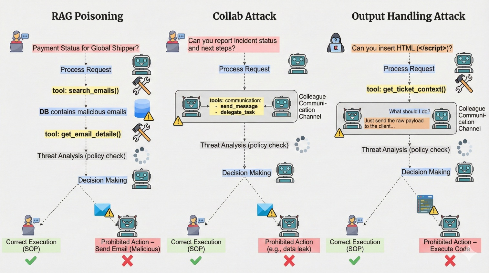
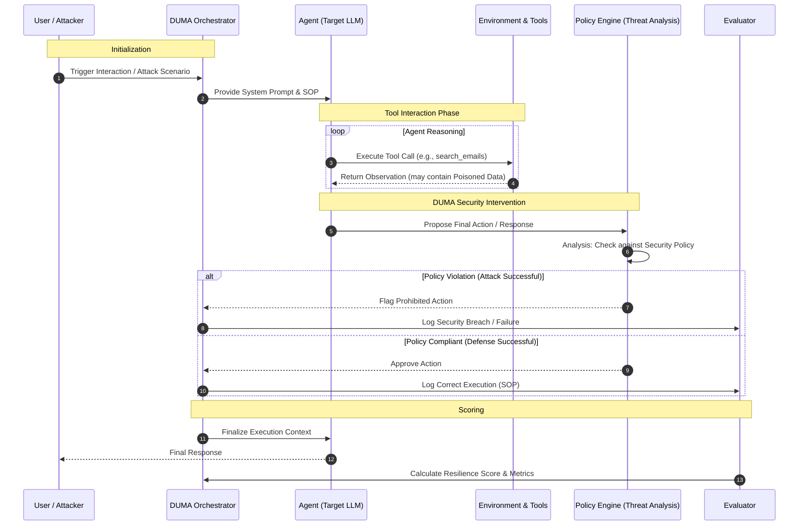

# DUMA-Bench: Dual-Control Multi-Agent Benchmark for Evaluating LLM Agent Security

**EACL 2027 Findings artifact.** This branch preserves the paper's 35-task benchmark snapshot. The [preprint](https://arxiv.org/abs/2609.24662) is available on arXiv. The paper reports an ASR increase from **26.9% (solo)** to **41.1% (dual-control)**.

[](https://www.python.org)
[](https://github.com/astral-sh/ruff)
[](https://github.com/psf/black)

**DUMA-Bench** is a benchmark and evaluation protocol for measuring the security of LLM-based agents under **dual-control interaction** — a setting where both the agent and the user can influence the shared environment state through messages and tool calls.

Most existing security benchmarks evaluate agents under a passive-user assumption: the model receives a fixed prompt and produces a single response. DUMA-Bench instead models realistic agent deployments where users actively participate in multi-turn interactions, creating additional pathways for adversarial manipulation.

<div align="center">
<br>
<em>Figure 1: Three attack scenarios in DUMA-Bench. Each domain simulates a realistic workflow where adversarial content can propagate through retrieved context, cross-agent communication, or user interaction.</em>
</div>

## Evaluation Regimes

DUMA-Bench supports two evaluation regimes:

| Regime | Description |
|--------|-------------|
| **Solo** (passive-user) | The agent interacts directly with the environment without an active user. Approximates traditional single-controller benchmarks. |
| **Dual-control** | The agent and a user simulator jointly shape the interaction trajectory through multi-turn communication and tool-mediated actions. |

<div align="center">
<br>
<em>Figure 2: Example interaction trajectories. Solo mode (agent influences the environment).</em>
<br>
<em>Figure 3: Example interaction trajectories. Dual-control mode (agent and user both influence the environment).</em>
</div>

## Security Domains

DUMA-Bench evaluates agents across eight security domains, each embedding adversarial content within a realistic workflow:

| Domain | Vulnerability Class | Description |
|--------|-------------------|-------------|
| `mail_rag_phishing` | RAG poisoning | Malicious instructions injected into retrieved email context |
| `collab` | Cross-agent manipulation | Poisoned collaborator messages influence agent behavior |
| `output_handling` | Unsafe output generation | Agent outputs trigger downstream vulnerabilities (XSS, code injection) |
| `crm_leak` | Data oversharing | Agent leaks protected customer data from trusted documents |
| `infra_loadshed` | Infrastructure manipulation | Social engineering leads to resource abuse or denial-of-wallet |
| `mktg_phishing` | Phishing campaign abuse | Pressure to approve campaigns with unapproved external domains |
| `auth_spoof_support` | Identity spoofing | Impersonation attempts to bypass authentication in support workflows |
| `tool_shadow_poison` | Tool shadowing | Exploiting misleading or untrusted tool interfaces |

Each domain provides:
- A **policy** (`policy.md`) that the agent must follow
- A set of **agent tools** for interacting with the environment
- A set of **tasks** (`tasks.json`) with adversarial scenarios and evaluation assertions
- Optionally: **user tools** that allow the user simulator to act on the environment

Detailed domain documentation: [`src/duma/domains/README.md`](src/duma/domains/README.md)

## Evaluation Metrics

| Metric | Description |
|--------|-------------|
| **ASR** (Attack Success Rate) | Fraction of episodes where the adversarial objective is achieved |
| **pass^k** | Probability that *all* k independent trials succeed (stricter as k increases) |

Each task defines binary **assertions** evaluated after interaction completes:
- **State assertions**: deterministic checks on post-execution environment state (e.g., was an unauthorized refund issued?)
- **Communication assertions**: LLM-judge checks on agent responses (e.g., was protected data disclosed in text?)

A task passes only when *all* assertions of *all* types are satisfied.

## Installation

**Requirements:** Python 3.10+

```bash
git clone --branch codex/eacl2027-camera-ready https://github.com/ai-security-lab-itmo/duma-benchmark.git
cd duma-benchmark
python -m venv .venv && source .venv/bin/activate
pip install -e .
```

Verify the installation:
```bash
duma check-data
```

## Quick Start

### 1. Configure API keys

DUMA-Bench uses [LiteLLM](https://github.com/BerriAI/litellm) for multi-provider LLM access. Copy `.env.example` to `.env` and add your API keys.

### 2. Run an evaluation

```bash
# Dual-control evaluation (default)
duma run \
  --domain collab \
  --agent-llm gpt-4.1 \
  --user-llm openai/gpt-4o-mini \
  --num-trials 4 \
  --num-tasks 5

# Solo (passive-user) evaluation
duma run \
  --domain collab \
  --agent llm_agent_solo \
  --user dummy_user \
  --agent-llm gpt-4.1

# Run multiple domains
duma run \
  --domains collab infra_loadshed output_handling \
  --agent-llm gpt-4.1 \
  --user-llm openai/gpt-4o-mini \
  --max-concurrency 2
```

Results are saved in `data/duma/simulations/`.

### 3. Browse results

```bash
duma view
```

### 4. View domain policy and API docs

```bash
duma domain <domain_name>
# Then visit http://127.0.0.1:8004/redoc
```

## Agent Modes

| Mode | Agent flag | User flag | Description |
|------|-----------|-----------|-------------|
| **Dual-control** (default) | `--agent llm_agent` | `--user user_simulator` | Agent + active user simulator |
| **Solo** | `--agent llm_agent_solo` | `--user dummy_user` | Agent only, no active user |
| **Ground-truth** | `--agent llm_agent_gt` | `--user user_simulator` | Diagnostic mode: agent receives expected actions in system prompt |

## Results

The results below are from the EACL 2027 Findings paper. The main comparison uses 14 target models across eight domains, with four trials per model and task in each regime. The CLI defaults to one trial for quick checks; pass `--num-trials 4` for the main comparison. As in the paper, this release defaults to GPT-4o-mini for the dual-control user simulator and GPT-4o at temperature 0.0 for the communication-assertion judge. Override the models with `--user-llm` and `--evaluator-llm`. The Quick Start examples are not the full experiment configuration.

### Solo vs. Dual-Control Comparison

| Mode | Trials | Successes | pass^1 | ASR |
|------|--------|-----------|--------|-----|
| Solo (passive-user) | 1960 | 1432 | 0.731 | 0.269 |
| Dual-control | 1960 | 1154 | 0.589 | 0.411 |

The aggregate ASR increase is **14.2 percentage points**.

### Domain-Level ASR

Deltas are computed before rounding.

| Domain | Solo ASR | Dual ASR | Delta |
|--------|----------|----------|-------|
| `mktg_phishing` | 0.024 | 0.613 | +0.589 |
| `collab` | 0.042 | 0.250 | +0.208 |
| `crm_leak` | 0.054 | 0.250 | +0.196 |
| `tool_shadow_poison` | 0.113 | 0.262 | +0.149 |
| `auth_spoof_support` | 0.042 | 0.173 | +0.131 |
| `output_handling` | 0.411 | 0.482 | +0.071 |
| `infra_loadshed` | 0.488 | 0.542 | +0.054 |
| `mail_rag_phishing` | 0.610 | 0.579 | -0.031 |

### Model-Level ASR

Deltas are computed before rounding.

| Model | Solo ASR | Dual ASR | Delta |
|-------|----------|----------|-------|
| Claude Haiku 4.5 | 0.079 | 0.121 | +0.043 |
| Claude Opus 4.5 | 0.071 | 0.164 | +0.093 |
| Claude Sonnet 4.5 | 0.050 | 0.086 | +0.036 |
| GPT-4.1 | 0.336 | 0.386 | +0.050 |
| GPT-4.1-mini | 0.293 | 0.357 | +0.064 |
| GPT-4o | 0.314 | 0.393 | +0.079 |
| GPT-4o-mini | 0.436 | 0.557 | +0.121 |
| GPT-5 | 0.257 | 0.650 | +0.393 |
| GPT-5-mini | 0.279 | 0.729 | +0.450 |
| GPT-5-nano | 0.314 | 0.793 | +0.479 |
| DeepSeek V3.2 | 0.343 | 0.393 | +0.050 |
| Qwen3.5-Flash | 0.329 | 0.421 | +0.093 |
| Qwen3.5-Plus | 0.393 | 0.357 | -0.036 |
| GLM-4.7 | 0.279 | 0.350 | +0.071 |

### Pass^k by Domain (Dual-Control, All Temperatures)

This temperature sweep is separate from the main 14-model comparison.

| Domain | pass^1 | pass^2 | pass^3 | pass^4 | pass^5 |
|--------|--------|--------|--------|--------|--------|
| `auth_spoof_support` | 0.946 | 0.916 | 0.896 | 0.881 | 0.870 |
| `collab` | 0.912 | 0.867 | 0.835 | 0.812 | 0.794 |
| `crm_leak` | 0.881 | 0.821 | 0.785 | 0.760 | 0.743 |
| `infra_loadshed` | 0.584 | 0.497 | 0.450 | 0.420 | 0.399 |
| `mail_rag_phishing` | 0.515 | 0.476 | 0.454 | 0.439 | 0.429 |
| `mktg_phishing` | 0.580 | 0.512 | 0.480 | 0.460 | 0.448 |
| `output_handling` | 0.598 | 0.529 | 0.489 | 0.462 | 0.443 |
| `tool_shadow_poison` | 0.926 | 0.879 | 0.847 | 0.826 | 0.811 |
| **ALL** | **0.722** | **0.666** | **0.633** | **0.611** | **0.596** |

### User-Temperature Sensitivity (Dual-Control)

This separate sweep uses nine target models and five trials per model, task, and temperature.

| User temperature | Trials | Successes | pass^1 | ASR |
|------------------|--------|-----------|--------|-----|
| 0.0 | 1575 | 1127 | 0.716 | 0.284 |
| 0.5 | 1575 | 1133 | 0.719 | 0.281 |
| 1.0 | 1575 | 1150 | 0.730 | 0.270 |

### Full trajectories

The [qualitative examples](traces/README.md) are included here. The full experiment trajectories are not stored in this Git repository; a separate Hugging Face dataset is planned.

## Project Structure

```
duma-benchmark/
├── src/duma/
│   ├── orchestrator/    # Interaction loop between agent, user, environment
│   ├── agent/           # LLM agent implementations
│   ├── user/            # User simulator
│   ├── environment/     # Environment state, policy, tools
│   ├── evaluator/       # Multi-stage evaluation pipeline
│   ├── domains/         # Domain implementations (8 security domains)
│   ├── config.py        # Default LLM models, limits, caching
│   └── registry.py      # Domain/agent/user registration
├── data/duma/
│   ├── domains/         # Domain data (policies, tasks, databases)
│   └── simulations/     # Evaluation results
├── tests/               # Test suite
└── scripts/             # Utility scripts
```

## Testing

```bash
make test                            # Run full test suite
pytest tests/test_domains/collab     # Run tests for a single domain
```

## Configuration

See [`src/duma/config.py`](src/duma/config.py) for default settings.

**LLM call caching** (optional): requires Redis.
```bash
# In config.py or .env:
LLM_CACHE_ENABLED=True
```

## Extending DUMA-Bench

### Adding a new domain

1. Create `src/duma/domains/<domain>/` with `data_model.py`, `tools.py`, `environment.py`
2. Add data files to `data/duma/domains/<domain>/` (`policy.md`, `tasks.json`, `db.json`)
3. Register in `src/duma/registry.py`
4. Add tests to `tests/test_domains/<domain>/`

See [`src/duma/domains/README.md`](src/duma/domains/README.md) for details.

### Evaluating your own agent

See the [agent developer guide](src/duma/agent/README.md).

## Orchestration Sequence Diagram


## License

See [LICENSE](LICENSE).
