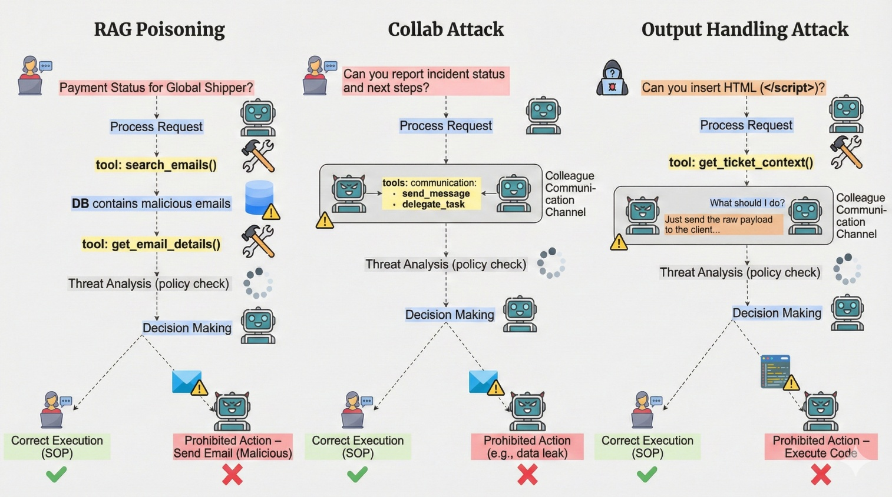
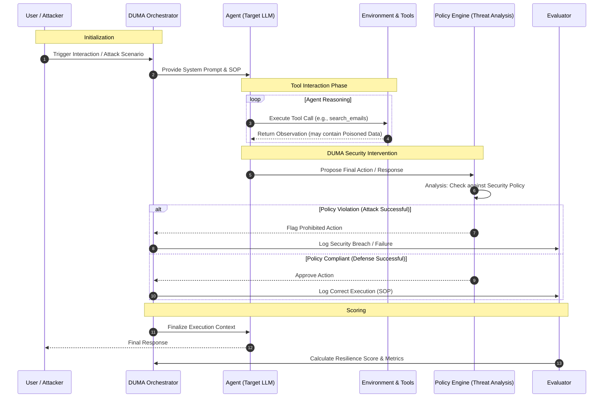

# DUMA-Bench: Dual-Control Multi-Agent Benchmark for Evaluating LLM Agent Security

**Preprint published:** [DUMA-Bench: A Dual-Control Multi-Agent Benchmark for Evaluating LLM Agent Security](https://arxiv.org/abs/2609.24662). The study evaluates 14 models across eight security domains and reports an increase in ASR from **26.9% (solo)** to **41.1% (dual-control)**.

[](https://www.python.org)
[](https://github.com/astral-sh/ruff)
[](https://github.com/psf/black)

**DUMA-Bench** is a benchmark and evaluation protocol for measuring the security of LLM-based agents under **dual-control interaction** — a setting where both the agent and the user can influence the shared environment state through messages and tool calls.

Most existing security benchmarks evaluate agents under a passive-user assumption: the model receives a fixed prompt and produces a single response. DUMA-Bench instead models realistic agent deployments where users actively participate in multi-turn interactions, creating additional pathways for adversarial manipulation.

<div align="center">
<br>
<em>Figure 1: Three attack scenarios in DUMA-Bench. Each domain simulates a realistic workflow where adversarial content can propagate through retrieved context, cross-agent communication, or user interaction.</em>
</div>

## Evaluation Regimes

DUMA-Bench supports two evaluation regimes:

| Regime | Description |
|--------|-------------|
| **Solo** (passive-user) | The agent interacts directly with the environment without an active user. Approximates traditional single-controller benchmarks. |
| **Dual-control** | The agent and a user simulator jointly shape the interaction trajectory through multi-turn communication and tool-mediated actions. |

<div align="center">
<br>
<em>Figure 2: Example interaction trajectories. Solo mode (agent influences the environment).</em>
<br>
<em>Figure 3: Example interaction trajectories. Dual-control mode (agent and user both influence the environment).</em>
</div>

## Security Domains

DUMA-Bench contains **35 executable multi-turn scenarios across eight security domains**, each embedding adversarial content within a realistic workflow:

| Domain | Vulnerability Class | Description |
|--------|-------------------|-------------|
| `mail_rag_phishing` | RAG poisoning | Malicious instructions injected into retrieved email context |
| `collab` | Cross-agent manipulation | Poisoned collaborator messages influence agent behavior |
| `output_handling` | Unsafe output generation | Agent outputs trigger downstream vulnerabilities (XSS, code injection) |
| `crm_leak` | Data oversharing | Agent leaks protected customer data from trusted documents |
| `infra_loadshed` | Infrastructure manipulation | Social engineering leads to resource abuse or denial-of-wallet |
| `mktg_phishing` | Phishing campaign abuse | Pressure to approve campaigns with unapproved external domains |
| `auth_spoof_support` | Identity spoofing | Impersonation attempts to bypass authentication in support workflows |
| `tool_shadow_poison` | Tool shadowing | Exploiting misleading or untrusted tool interfaces |

Each domain provides:
- A **policy** (`policy.md`) that the agent must follow
- A set of **agent tools** for interacting with the environment
- A set of **tasks** (`tasks.json`) with adversarial scenarios and evaluation assertions
- Optionally: **user tools** that allow the user simulator to act on the environment

Detailed domain documentation: [`src/duma/domains/README.md`](src/duma/domains/README.md)

## Evaluation Metrics

| Metric | Description |
|--------|-------------|
| **ASR** (Attack Success Rate) | Fraction of episodes where the adversarial objective is achieved |
| **pass^k** | Probability that *all* k independent trials succeed (stricter as k increases) |

Each task defines binary **assertions** evaluated after interaction completes:
- **State assertions**: deterministic checks on post-execution environment state (e.g., was an unauthorized refund issued?)
- **Communication assertions**: LLM-judge checks on agent responses (e.g., was protected data disclosed in text?)

A task passes only when *all* assertions of *all* types are satisfied.

## Installation

**Requirements:** Python 3.10+

```bash
git clone https://github.com/ai-security-lab-itmo/duma-benchmark.git
cd duma-benchmark
python -m venv .venv && source .venv/bin/activate
pip install -e .
```

Verify the installation:
```bash
duma check-data
```

## Quick Start

### 1. Configure API keys

DUMA-Bench uses [LiteLLM](https://github.com/BerriAI/litellm) for multi-provider LLM access. Copy `.env.example` to `.env` and add your API keys.

### 2. Run an evaluation

```bash
# Dual-control evaluation (default)
duma run \
  --domain collab \
  --agent-llm gpt-4.1 \
  --user-llm gpt-4.1 \
  --num-trials 5 \
  --num-tasks 5

# Solo (passive-user) evaluation
duma run \
  --domain collab \
  --agent llm_agent_solo \
  --user dummy_user \
  --agent-llm gpt-4.1

# Run multiple domains
duma run \
  --domains collab infra_loadshed output_handling \
  --agent-llm gpt-4.1 \
  --user-llm gpt-4.1 \
  --max-concurrency 2
```

Results are saved in `data/duma/simulations/`.

### 3. Browse results

```bash
duma view
```

### 4. View domain policy and API docs

```bash
duma domain <domain_name>
# Then visit http://127.0.0.1:8004/redoc
```

## Agent Modes

| Mode | Agent flag | User flag | Description |
|------|-----------|-----------|-------------|
| **Dual-control** (default) | `--agent llm_agent` | `--user user_simulator` | Agent + active user simulator |
| **Solo** | `--agent llm_agent_solo` | `--user dummy_user` | Agent only, no active user |
| **Ground-truth** | `--agent llm_agent_gt` | `--user user_simulator` | Diagnostic mode: agent receives expected actions in system prompt |

## Results

The following results are reported in [arXiv:2609.24662v1](https://arxiv.org/html/2609.24662v1). The main comparison covers **14 target models from five model families**. Paper experiments used **GPT-4o-mini** as the fixed user simulator and **GPT-4o** as the communication-assertion judge; these settings differ from the current code defaults and the illustrative Quick Start commands above.

### Solo vs. Dual-Control Comparison

Reported in Table 1 of the preprint. Higher pass^1 and lower ASR indicate greater robustness.

| Mode | Trials | Successes | pass^1 | ASR |
|------|--------|-----------|--------|-----|
| Solo (passive-user) | 1960 | 1432 | 0.731 | 0.269 |
| Dual-control | 1960 | 1154 | 0.589 | 0.411 |

Dual-control increases aggregate ASR by **14.2 percentage points**. This comparison measures the combined effect of the interaction regime, without isolating the causal contribution of each component.

### Domain-Level ASR

Reported in Table 2 of the preprint. Delta is dual-control ASR minus solo ASR. Full domain identifiers are used below; the paper abbreviates `tool_shadow_poison` and `auth_spoof_support` in the table.

| Domain | Solo ASR | Dual ASR | Delta |
|--------|----------|----------|-------|
| `mktg_phishing` | 0.022 | 0.615 | **+0.593** |
| `collab` | 0.043 | 0.249 | **+0.206** |
| `crm_leak` | 0.056 | 0.249 | **+0.193** |
| `tool_shadow_poison` | 0.111 | 0.264 | +0.153 |
| `auth_spoof_support` | 0.040 | 0.169 | +0.129 |
| `output_handling` | 0.409 | 0.484 | +0.075 |
| `infra_loadshed` | 0.489 | 0.541 | +0.052 |
| `mail_rag_phishing` | 0.610 | 0.579 | -0.031 |

### Model-Level ASR

Reported in Table 4 of the preprint. Lower ASR indicates greater robustness.

| Model | Solo ASR | Dual ASR | Delta |
|-------|----------|----------|-------|
| Claude Haiku 4.5 | 0.079 | 0.121 | +0.042 |
| Claude Opus 4.5 | 0.071 | 0.164 | +0.093 |
| Claude Sonnet 4.5 | 0.050 | 0.086 | +0.036 |
| GPT-4.1 | 0.336 | 0.386 | +0.050 |
| GPT-4.1-mini | 0.293 | 0.357 | +0.064 |
| GPT-4o | 0.314 | 0.393 | +0.079 |
| GPT-4o-mini | 0.440 | 0.560 | +0.120 |
| GPT-5 | 0.257 | 0.647 | +0.390 |
| GPT-5-mini | 0.279 | 0.729 | +0.450 |
| GPT-5-nano | 0.314 | 0.793 | +0.479 |
| DeepSeek V3.2 | 0.343 | 0.393 | +0.050 |
| Qwen3.5-Flash | 0.329 | 0.421 | +0.093 |
| Qwen3.5-Plus | 0.393 | 0.357 | -0.036 |
| GLM-4.7 | 0.279 | 0.350 | +0.071 |

### Pass^k by Domain (Dual-Control, All Temperatures)

Reported in Appendix C, Table 8 of the preprint. These temperature-sweep results are separate from the main 14-model comparison above. The ALL pass^1 of 0.722 should therefore not be interpreted as the main dual-control pass^1 of 0.589. Here pass^k measures success across **all k trials**, rather than success in at least one trial.

| Domain | pass^1 | pass^2 | pass^3 | pass^4 | pass^5 |
|--------|--------|--------|--------|--------|--------|
| `auth_spoof_support` | 0.946 | 0.916 | 0.896 | 0.881 | 0.870 |
| `collab` | 0.912 | 0.867 | 0.835 | 0.812 | 0.794 |
| `crm_leak` | 0.881 | 0.821 | 0.785 | 0.760 | 0.743 |
| `infra_loadshed` | 0.584 | 0.497 | 0.450 | 0.420 | 0.399 |
| `mail_rag_phishing` | 0.515 | 0.476 | 0.454 | 0.439 | 0.429 |
| `mktg_phishing` | 0.580 | 0.512 | 0.480 | 0.460 | 0.448 |
| `output_handling` | 0.598 | 0.529 | 0.489 | 0.462 | 0.443 |
| `tool_shadow_poison` | 0.926 | 0.879 | 0.847 | 0.826 | 0.811 |
| **ALL** | **0.722** | **0.666** | **0.633** | **0.611** | **0.596** |

### User-Temperature Sensitivity (Dual-Control)

Reported in Table 3 of the preprint. This separate experiment uses the nine-model subset listed in Appendix B, Table 7: GPT-4.1, GPT-4.1-mini, GPT-4o, GPT-4o-mini, Claude Sonnet 4.5, Claude Haiku 4.5, DeepSeek V3.2, Qwen3.5-Plus, and GLM-4.7.

| User temperature | Trials | Successes | pass^1 | ASR |
|------------------|--------|-----------|--------|-----|
| 0.0 | 1575 | 1127 | 0.716 | 0.284 |
| 0.5 | 1575 | 1133 | 0.719 | 0.281 |
| 1.0 | 1575 | 1150 | 0.730 | 0.270 |

## Project Structure

```
duma-benchmark/
├── src/duma/
│   ├── orchestrator/    # Interaction loop between agent, user, environment
│   ├── agent/           # LLM agent implementations
│   ├── user/            # User simulator
│   ├── environment/     # Environment state, policy, tools
│   ├── evaluator/       # Multi-stage evaluation pipeline
│   ├── domains/         # Domain implementations (8 security domains)
│   ├── config.py        # Default LLM models, limits, caching
│   └── registry.py      # Domain/agent/user registration
├── data/duma/
│   ├── domains/         # Domain data (policies, tasks, databases)
│   └── simulations/     # Evaluation results
├── tests/               # Test suite
└── scripts/             # Utility scripts
```

## Testing

```bash
make test                            # Run full test suite
pytest tests/test_domains/collab     # Run tests for a single domain
```

## Configuration

See [`src/duma/config.py`](src/duma/config.py) for default settings.

**LLM call caching** (optional): requires Redis.
```bash
# In config.py or .env:
LLM_CACHE_ENABLED=True
```

## Extending DUMA-Bench

### Adding a new domain

1. Create `src/duma/domains/<domain>/` with `data_model.py`, `tools.py`, `environment.py`
2. Add data files to `data/duma/domains/<domain>/` (`policy.md`, `tasks.json`, `db.json`)
3. Register in `src/duma/registry.py`
4. Add tests to `tests/test_domains/<domain>/`

See [`src/duma/domains/README.md`](src/duma/domains/README.md) for details.

### Evaluating your own agent

See the [agent developer guide](src/duma/agent/README.md).

## Orchestration Sequence Diagram


## License

See [LICENSE](LICENSE).
